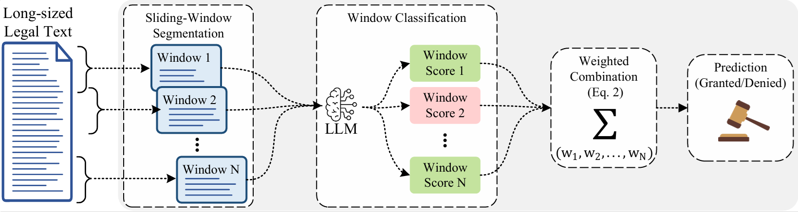

# A Context-Preserving Large Language Model Framework for Legal Decision Prediction in Brazilian Habeas Corpus Proceedings

This repository contains the source code and experimental implementations associated with the paper.

## Abstract

Legal Judgment Prediction using BERT-based language models faces a fundamental limitation when legal documents exceed the maximum input length supported by these models. In such cases, relevant information located beyond the initial input window may be disregarded, potentially affecting predictive performance. This repository accompanies a study that investigates the prediction of Habeas Corpus outcomes in the Brazilian Superior Court of Justice using the textual content of judicial reports.The proposed framework addresses the challenge of processing long legal documents through a context-preserving strategy based on sliding-window segmentation and contextual representation aggregation. Long texts are divided into multiple chunks, which are processed by pretrained language models and combined using pooling mechanisms to preserve information distributed throughout the document. The experimental evaluation compares the traditional truncation approach with different sliding-window configurations using Legal BERT, Legal-BERTimbau, BERTimbau, and Multilingual BERT. Results demonstrate that preserving information beyond the initial BERT input window improves predictive performance for long legal texts. The best-performing configuration combines Legal BERT with Mean Pooling and no overlap between consecutive chunks, outperforming the traditional truncation strategy. The findings also show that increasing overlap between chunks does not necessarily improve predictive performance and may introduce additional computational cost. These results highlight the importance of balancing predictive effectiveness and inference efficiency when designing Legal Judgment Prediction systems for long legal documents.

## Overview

This framework addresses Legal Judgment Prediction (LJP) for Brazilian Habeas Corpus proceedings by combining pretrained BERT-based language models with a context-preserving sliding-window strategy. The methodology comprises four main stages: construction of a dataset from public records, preprocessing and tokenization of judicial reports, segmentation of long documents into multiple chunks with configurable stride, and aggregation of chunk representations through pooling mechanisms for classification.

<p align="center">
  
</p>

The experimental evaluation compares traditional truncation against long-document processing strategies across general-purpose and legal-domain language models, assessing both predictive performance and computational cost.

## Pipeline

```text
Extraction of Habeas Corpus Proceedings
                 ↓
         Data Preprocessing
                 ↓
       Dataset Construction
                 ↓
          Model Training
```
The pipeline begins with the extraction of Habeas Corpus proceedings from the Open Data Portal, followed by data preprocessing and dataset construction. The resulting dataset is then used to train and evaluate language models for Legal Judgment Prediction in long legal documents.

## Repository Organization

The repository is organized as follows:

```text
.
├── CITATION.cff
├── LICENSE
├── README.md
├── data/
│   └── dataset_decisoes_acordaos_HC_2021_2025.zip
├── docs/
│   ├── archictecture/
│   │   ├── proposal.pdf
│   │   └── proposal.png
│   └── samples/
│       ├── 202500001724_DECISAO.pdf
│       ├── 202500069962_ACORDAO.pdf
│       └── README.md
└── src/
    ├── ExtracaoDadosAbertos/       # Git submodule: Open Data scraper
    └── jupyter-notebooks/
        ├── Preprocess_DataSet.ipynb
        ├── preprocessing.ipynb
        ├── EDA_DataSet(Tokenization_Undersampling_and_Tradeoff).ipynb
        ├── BERT_HabeasCorpus(Train_and_Inference_Models).ipynb
        └── README.md
```

### Directory & File Descriptions

- **`data/`**:
  - `dataset_decisoes_acordaos_HC_2021_2025.zip`: Compressed archive containing the dataset of Habeas Corpus decisions and collegiate judgments (*acórdãos*) spanning from 2021 to 2025.

- **`docs/`**:
  - `archictecture/`: Conceptual architecture and workflow diagrams illustrating the sliding-window chunking, transformer backbone processing, and contextual representation pooling mechanisms (`proposal.png` / `proposal.pdf`).
  - `samples/`: Representative samples of judicial documents (monocratic decision and collegiate judgment) for qualitative analysis of model inputs, with documentation and verification links to the official court portal.

- **`src/ExtracaoDadosAbertos/`**:
  - Git submodule linking to the extraction tool used to harvest raw Habeas Corpus proceedings and judicial metadata from the Open Data Portal.

- **`src/jupyter-notebooks/`**:
  - Detailed parameter guide and step-by-step instructions available in [`src/jupyter-notebooks/README.md`](src/jupyter-notebooks/README.md).
  - `Preprocess_DataSet.ipynb`: Loads extracted decisions, parses judicial metadata (judge/rapporteur, case registry, full text), and formats binary classification labels.
  - `preprocessing.ipynb`: Implements text normalization routines and linguistic preprocessing considerations specifically designed for legal texts.
  - `EDA_DataSet(Tokenization_Undersampling_and_Tradeoff).ipynb`: Conducts exploratory data analysis, token length distribution profiling, undersampling for class balance, and dataset splitting for short vs. long text evaluation.
  - `BERT_HabeasCorpus(Train_and_Inference_Models).ipynb`: Implements model training, fine-tuning, and inference across BERT-based models (Legal BERT, Legal-BERTimbau, BERTimbau, and Multilingual BERT), incorporating sliding-window segmentation, pooling aggregation strategies, ROC evaluation curves, and computational latency trade-offs.

- **Root Files**:
  - `CITATION.cff`: Citation metadata format for referencing this research and software.
  - `LICENSE`: License terms and conditions for repository distribution.

## Dataset

The dataset contains Habeas Corpus proceedings adjudicated by the Superior Court of Justice between 2021 and 2025, including both monocratic decisions and collegiate judgments (*acórdãos*) obtained from the court's Open Data Portal. A total of 404,578 records were extracted and labeled according to the judgment outcome, resulting in a binary classification task with the classes granted and denied, and were partitioned into training and test sets using a 70/30 split. The final dataset presents a severe class imbalance, with a substantial predominance of denied petitions over granted petitions, reflecting the distribution observed in real judicial practice.

### Document Samples & Public Access

Representative samples of the raw judicial documents analyzed and classified by the models are available in the [`docs/samples/`](docs/samples/) directory:
- **Monocratic Decision (*Decisão Monocrática*)**: [`202500001724_DECISAO.pdf`](docs/samples/202500001724_DECISAO.pdf)
- **Collegiate Court Judgment (*Acórdão*)**: [`202500069962_ACORDAO.pdf`](docs/samples/202500069962_ACORDAO.pdf)

These documents are public records from the Superior Court of Justice. The original proceedings and their complete procedural history can be consulted publicly on the official [Procedural Search Portal](https://processo.stj.jus.br/processo/pesquisa/?aplicacao=processos.ea) using their respective case registration numbers (`202500001724` and `202500069962`).

## Citation

If you use this repository in academic work, please cite the associated paper.

The repository also includes CITATION.cff for citation metadata.